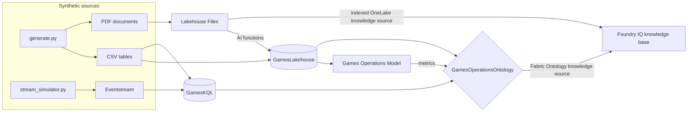
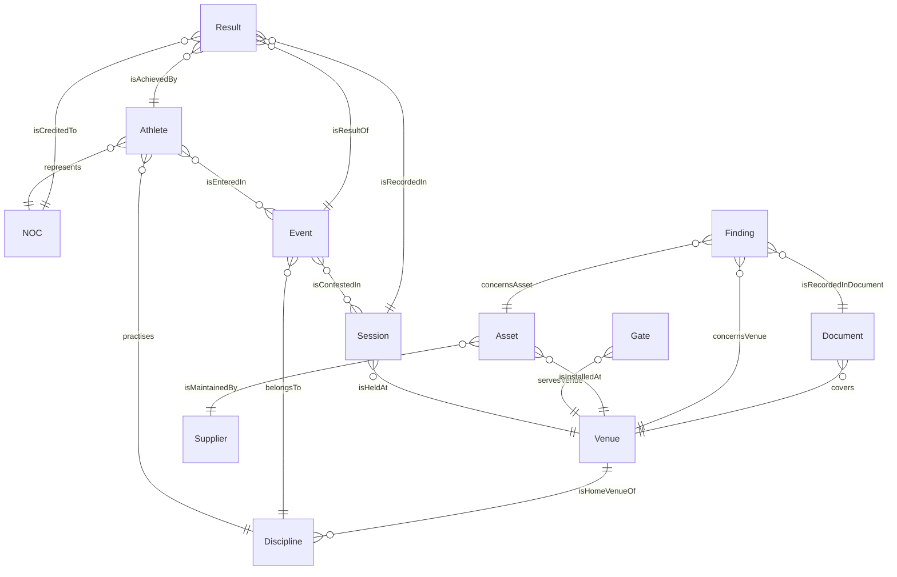

# Games operations ontology: design

Design of the Fabric IQ ontology, its data sources and the semantic model for the synthetic
**Valmont Winter Games** sample. The ontology is the semantic layer that Foundry agents, Copilot Studio agents
and Microsoft 365 Copilot use to answer Games-time operations questions over structured data, real-time
telemetry and facts extracted from documents.

> All data is synthetic. National committee codes and country names are public; venues, athletes, assets,
> suppliers, people, thresholds and findings are fictional.

This document is generated from `generator/ontology_spec.py` by `generator/render_design.py`. Change the
specification, not this file, then regenerate.

## 1. Scenario

Games-time operations for a winter multi-sport event with 10 venues in three clusters, 40 medal events,
about 1,300 athletes from 40 national committees, 41 spectator gates and about 220 venue assets.
By default the Games open on **16 November 2026** and the data cut-off is **24 November 2026, 11:00 UTC**
(competition day 9), so the workshop day is "today" in the data.

The ontology must answer questions such as:

| Question | Sources it needs |
|---|---|
| Which venues host sessions tomorrow, and which Critical assets serve them? | Lakehouse through the ontology |
| Which NOCs lead the medal table? What is the attendance rate at a venue? | Semantic model metrics |
| Which gate exceeded the crowd density limit, and for how long? | Eventhouse time series |
| Which sessions are at risk from open High findings, and what did the inspector recommend? | Ontology plus documents |
| What is the wind limit for a venue? (a superseded manual says otherwise) | Documents plus the governed document register |

## 2. Sources and how each reaches the ontology

| Source | Fabric item | Content | Role in the ontology |
|---|---|---|---|
| Lakehouse | `GamesLakehouse` | 16 Delta tables: master data, schedule, results, assets, document register, extracted findings, row-level security mapping | Static entity and relationship bindings |
| Eventhouse | `GamesEventhouse` / `GamesKQL` | 4 tables: venue conditions, gate flow, asset telemetry, live timing | Time series bindings on Venue, Gate, Asset and Athlete |
| Semantic model | `Games Operations Model` (Direct Lake) | Medal, ticketing and attendance measures; row-level security by NOC | Metrics (DAX measures referenced by the ontology) |
| Documents | Lakehouse **Files** | 51 PDF manuals, inspection reports, transport plans and policies | Path A: AI functions extract findings into the `finding` table. Path B: full text indexed for Foundry IQ |

**Why this split.** As per official documentation, ontology binding reads data that is already in Fabric
(eventhouse, KQL database, lakehouse, mirrored database, semantic model, SQL database, warehouse). Static
bindings use the lakehouse so every entity type and relationship comes from one source type, which keeps the
pilot simple. The eventhouse adds live state as time series. The semantic model stays the owner of the
business calculations and the row-level security, and the ontology reuses its measures as metrics instead of
redefining them.

## 3. Entity types

| Entity type | Key | Static binding (lakehouse table) | Time series (eventhouse table) | Description |
|---|---|---|---|---|
| **NOC** | `noc_code` (string) | `noc` | - | A national committee and its delegation at the Games. |
| **Athlete** | `athlete_id` (string) | `athlete` | `TimingEvents` on `AthleteId` | A competitor entered by a national committee. |
| **Discipline** | `discipline_code` (string) | `discipline` | - | A discipline within a sport, played at one home venue. |
| **Event** | `event_id` (string) | `event` | - | A medal event, for example Women's 10 km Pursuit. |
| **Session** | `session_id` (string) | `session` + `session_ticketing` (secondary) | - | A ticketed competition session at a venue. |
| **Result** | `result_id` (string) | `result` | - | A ranked result recorded in a session; team results have no athlete. |
| **Venue** | `venue_id` (string) | `venue` | `VenueConditions` on `VenueId` | A competition venue with its operating limits. |
| **Gate** | `gate_id` (string) | `gate` | `GateFlow` on `GateId` | A spectator gate and its queueing plaza. |
| **Asset** | `asset_id` (string) | `asset` | `AssetTelemetry` on `AssetId` | Venue equipment, with criticality and service history. |
| **Supplier** | `supplier_id` (string) | `supplier` | - | A contractor that maintains venue assets. |
| **Finding** | `finding_id` (string) | `finding` | - | An inspection finding extracted from an inspection report (AI functions). |
| **Document** | `document_id` (string) | `document_register` | - | A controlled document: manual, inspection report, plan or policy. |

Entity keys are strings, which the ontology supports as key types (string or integer). Property names are business names; the column each one binds to is shown below.

### NOC

| Property | Type | Bound column | Description |
|---|---|---|---|
| NocCode | string | `noc.noc_code` | Three-letter national committee code (entity key) |
| Name | string | `noc.noc_name` | Country or territory name |
| Region | string | `noc.region` | Continental region |
| DelegationSize | integer | `noc.delegation_size` | Number of athletes entered |

### Athlete

| Property | Type | Bound column | Description |
|---|---|---|---|
| AthleteId | string | `athlete.athlete_id` | Athlete code (entity key) |
| GivenName | string | `athlete.given_name` | Fictional given name |
| FamilyName | string | `athlete.family_name` | Fictional family name |
| Category | string | `athlete.gender_category` | Competition category M or W |
| BirthYear | integer | `athlete.birth_year` | Year of birth |
| NocCode | string | `athlete.noc_code` | National committee the athlete represents |
| DisciplineCode | string | `athlete.discipline_code` | Main discipline |
| SessionId | string (time series) | `TimingEvents.SessionId` | Session |
| EventId | string (time series) | `TimingEvents.EventId` | Event |
| Checkpoint | string (time series) | `TimingEvents.Checkpoint` | Checkpoint name |
| LapNumber | integer (time series) | `TimingEvents.LapNumber` | Lap number |
| SplitTimeS | double (time series) | `TimingEvents.SplitTimeS` | Elapsed time since start, seconds |
| ShootingMisses | integer (time series) | `TimingEvents.ShootingMisses` | Misses at a shooting stage (biathlon) |
| RankAtCheckpoint | integer (time series) | `TimingEvents.RankAtCheckpoint` | Rank at the checkpoint |

### Discipline

| Property | Type | Bound column | Description |
|---|---|---|---|
| DisciplineCode | string | `discipline.discipline_code` | Discipline code (entity key) |
| Name | string | `discipline.discipline_name` | Discipline name |
| Sport | string | `discipline.sport_name` | Parent sport |
| VenueId | string | `discipline.venue_id` | Home venue |
| ScoringType | string | `discipline.scoring_type` | timed, judged or team |

### Event

| Property | Type | Bound column | Description |
|---|---|---|---|
| EventId | string | `event.event_id` | Medal event code (entity key) |
| Name | string | `event.event_name` | Event name |
| DisciplineCode | string | `event.discipline_code` | Discipline of the event |
| Category | string | `event.gender_category` | M, W or X (mixed) |
| IsTeamEvent | boolean | `event.is_team_event` | True when medals go to a team |
| MedalDate | datetime | `event.medal_date` | Date of the medal session |
| HasQualification | boolean | `event.has_qualification` | True when a qualification session precedes the final |

### Session

| Property | Type | Bound column | Description |
|---|---|---|---|
| SessionId | string | `session.session_id` | Competition session code (entity key) |
| VenueId | string | `session.venue_id` | Venue of the session |
| CompetitionDay | integer | `session.competition_day` | Day number of the Games, 1 = opening day |
| SessionDate | datetime | `session.session_date` | Session date (UTC) |
| StartTimeUtc | datetime | `session.start_time_utc` | Scheduled start (UTC) |
| EndTimeUtc | datetime | `session.end_time_utc` | Scheduled end (UTC) |
| SessionType | string | `session.session_type` | Qualification, Final, Preliminary round or Medal game |
| Status | string | `session.session_status` | Completed, In progress, Scheduled or Postponed |
| StatusReason | string | `session.status_reason` | Reason for a postponement, if any |
| SeatsAvailable | integer | `session_ticketing.seats_available` (joined on `session_id`) | Seats on sale |
| TicketsSold | integer | `session_ticketing.tickets_sold` (joined on `session_id`) | Tickets sold |
| ScannedEntries | integer | `session_ticketing.scanned_entries` (joined on `session_id`) | Spectators scanned at the gates (completed sessions) |

### Result

| Property | Type | Bound column | Description |
|---|---|---|---|
| ResultId | string | `result.result_id` | Result code (entity key) |
| EventId | string | `result.event_id` | Event |
| SessionId | string | `result.session_id` | Session in which the result was recorded |
| NocCode | string | `result.noc_code` | National committee credited with the result |
| AthleteId | string | `result.athlete_id` | Athlete (empty for team results) |
| Rank | integer | `result.result_rank` | Rank in the session |
| Mark | double | `result.mark` | Time in seconds, points, or score |
| MarkUnit | string | `result.mark_unit` | seconds, points or score |
| Medal | string | `result.medal` | Gold, Silver, Bronze or empty |

### Venue

| Property | Type | Bound column | Description |
|---|---|---|---|
| VenueId | string | `venue.venue_id` | Venue code (entity key) |
| Name | string | `venue.venue_name` | Venue name |
| Cluster | string | `venue.cluster_name` | Venue cluster |
| Environment | string | `venue.environment` | indoor or outdoor |
| SeatingCapacity | integer | `venue.seating_capacity` | Spectator capacity |
| GateCount | integer | `venue.gate_count` | Number of spectator gates |
| WindLimitMs | double | `venue.wind_limit_ms` | Operating wind gust limit in m/s (outdoor only) |
| CrowdDensityLimit | double | `venue.crowd_density_limit` | Gate density limit in persons per square metre |
| Latitude | double | `venue.latitude` | Synthetic latitude |
| Longitude | double | `venue.longitude` | Synthetic longitude |
| WindSpeedMs | double (time series) | `VenueConditions.WindSpeedMs` | Mean wind speed, m/s (outdoor) |
| WindGustMs | double (time series) | `VenueConditions.WindGustMs` | Wind gust, m/s (outdoor) |
| AirTempC | double (time series) | `VenueConditions.AirTempC` | Air temperature, degrees C |
| SnowTempC | double (time series) | `VenueConditions.SnowTempC` | Snow surface temperature, degrees C (outdoor) |
| HumidityPct | double (time series) | `VenueConditions.HumidityPct` | Relative humidity, percent |
| VisibilityM | integer (time series) | `VenueConditions.VisibilityM` | Visibility, metres |

### Gate

| Property | Type | Bound column | Description |
|---|---|---|---|
| GateId | string | `gate.gate_id` | Gate code (entity key) |
| VenueId | string | `gate.venue_id` | Venue of the gate |
| Name | string | `gate.gate_name` | Gate name |
| PlazaAreaM2 | integer | `gate.plaza_area_m2` | Queueing area in front of the gate |
| MaxEntriesPerMin | integer | `gate.max_entries_per_min` | Design throughput |
| EntriesPerMin | integer (time series) | `GateFlow.EntriesPerMin` | Spectators scanned in the minute |
| QueueingPersons | integer (time series) | `GateFlow.QueueingPersons` | People in the gate plaza |
| DensityPersonsPerM2 | double (time series) | `GateFlow.DensityPersonsPerM2` | Plaza density, persons per square metre |

### Asset

| Property | Type | Bound column | Description |
|---|---|---|---|
| AssetId | string | `asset.asset_id` | Asset code (entity key) |
| VenueId | string | `asset.venue_id` | Venue where the asset is installed |
| Name | string | `asset.asset_name` | Asset name |
| AssetType | string | `asset.asset_type` | Asset type |
| Criticality | string | `asset.criticality` | Critical, High or Medium |
| OperationalStatus | string | `asset.operational_status` | Operational, Degraded or Out of service |
| IsMonitored | boolean | `asset.is_monitored` | True when the asset streams telemetry |
| SupplierId | string | `asset.supplier_id` | Supplier that maintains the asset |
| InstallDate | datetime | `asset.install_date` | Installation date |
| LastServiceDate | datetime | `asset.last_service_date` | Date of the last service |
| TemperatureC | double (time series) | `AssetTelemetry.TemperatureC` | Process temperature (brine, supply air, coolant), degrees C |
| PowerKw | double (time series) | `AssetTelemetry.PowerKw` | Power draw, kW |
| StatusCode | string (time series) | `AssetTelemetry.StatusCode` | OK, WARNING or ALARM |

### Supplier

| Property | Type | Bound column | Description |
|---|---|---|---|
| SupplierId | string | `supplier.supplier_id` | Supplier code (entity key) |
| Name | string | `supplier.supplier_name` | Fictional supplier name |
| ServiceCategory | string | `supplier.service_category` | Service category |

### Finding

| Property | Type | Bound column | Description |
|---|---|---|---|
| FindingId | string | `finding.finding_id` | Finding code (entity key) |
| DocumentId | string | `finding.document_id` | Inspection report that records the finding |
| VenueId | string | `finding.venue_id` | Venue concerned |
| AssetId | string | `finding.asset_id` | Asset concerned (may be empty) |
| InspectionDate | datetime | `finding.inspection_date` | Inspection date |
| Severity | string | `finding.severity` | Low, Medium or High |
| Category | string | `finding.category` | Finding category |
| Description | string | `finding.description` | What the inspector observed |
| Recommendation | string | `finding.recommendation` | What the inspector recommended |
| Status | string | `finding.finding_status` | Open or Closed |
| DueDate | datetime | `finding.due_date` | Date by which the finding must be resolved |

### Document

| Property | Type | Bound column | Description |
|---|---|---|---|
| DocumentId | string | `document_register.document_id` | Document code (entity key) |
| Title | string | `document_register.title` | Document title |
| DocumentType | string | `document_register.document_type` | Venue operations manual, Inspection report, Transport plan or Games-wide policy |
| VenueId | string | `document_register.venue_id` | Venue covered (empty for Games-wide documents) |
| Version | string | `document_register.version` | Version label |
| Status | string | `document_register.document_status` | Current or Superseded |
| EffectiveDate | datetime | `document_register.effective_date` | Date the version took effect |
| Sensitivity | string | `document_register.sensitivity` | General or Confidential (label to apply in Microsoft Purview) |
| OneLakePath | string | `document_register.onelake_path` | Path under the lakehouse Files area |

## 4. Relationship types

Each relationship is bound to the lakehouse table that holds both keys.

| Relationship | Source → target | Binding table | Source key → target key | Cardinality |
|---|---|---|---|---|
| Athlete **represents** NOC | Athlete → NOC | `athlete` | `athlete_id` → `noc_code` | many-to-one |
| Athlete **practises** Discipline | Athlete → Discipline | `athlete` | `athlete_id` → `discipline_code` | many-to-one |
| Athlete **isEnteredIn** Event | Athlete → Event | `entry` | `athlete_id` → `event_id` | many-to-many |
| Event **belongsTo** Discipline | Event → Discipline | `event` | `event_id` → `discipline_code` | many-to-one |
| Event **isContestedIn** Session | Event → Session | `session_event` | `event_id` → `session_id` | many-to-many |
| Session **isHeldAt** Venue | Session → Venue | `session` | `session_id` → `venue_id` | many-to-one |
| Venue **isHomeVenueOf** Discipline | Venue → Discipline | `discipline` | `venue_id` → `discipline_code` | one-to-many |
| Result **isResultOf** Event | Result → Event | `result` | `result_id` → `event_id` | many-to-one |
| Result **isRecordedIn** Session | Result → Session | `result` | `result_id` → `session_id` | many-to-one |
| Result **isCreditedTo** NOC | Result → NOC | `result` | `result_id` → `noc_code` | many-to-one |
| Result **isAchievedBy** Athlete | Result → Athlete | `result` | `result_id` → `athlete_id` | many-to-one |
| Gate **servesVenue** Venue | Gate → Venue | `gate` | `gate_id` → `venue_id` | many-to-one |
| Asset **isInstalledAt** Venue | Asset → Venue | `asset` | `asset_id` → `venue_id` | many-to-one |
| Asset **isMaintainedBy** Supplier | Asset → Supplier | `asset` | `asset_id` → `supplier_id` | many-to-one |
| Finding **concernsVenue** Venue | Finding → Venue | `finding` | `finding_id` → `venue_id` | many-to-one |
| Finding **concernsAsset** Asset | Finding → Asset | `finding` | `finding_id` → `asset_id` | many-to-one |
| Finding **isRecordedInDocument** Document | Finding → Document | `finding` | `finding_id` → `document_id` | many-to-one |
| Document **covers** Venue | Document → Venue | `document_register` | `document_id` → `venue_id` | many-to-one |

## 5. Metrics (semantic model measures)

Defined once in **Games Operations Model** and referenced by the ontology as metrics; the semantic model keeps ownership of the DAX expression.

| Metric | Home table | DAX | Used with |
|---|---|---|---|
| Gold Medals | `result` | `CALCULATE ( COUNTROWS ( 'result' ), 'result'[medal] = "Gold" )` | NOC |
| Silver Medals | `result` | `CALCULATE ( COUNTROWS ( 'result' ), 'result'[medal] = "Silver" )` | NOC |
| Bronze Medals | `result` | `CALCULATE ( COUNTROWS ( 'result' ), 'result'[medal] = "Bronze" )` | NOC |
| Total Medals | `result` | `[Gold Medals] + [Silver Medals] + [Bronze Medals]` | NOC |
| Tickets Sold | `session_ticketing` | `SUM ( 'session_ticketing'[tickets_sold] )` | Session, Venue |
| Seats Available | `session_ticketing` | `SUM ( 'session_ticketing'[seats_available] )` | Session, Venue |
| Sell-Through Rate | `session_ticketing` | `DIVIDE ( [Tickets Sold], [Seats Available] )` | Session, Venue |
| Attendance Rate | `session_ticketing` | `DIVIDE ( SUM ( 'session_ticketing'[scanned_entries] ), CALCULATE ( [Tickets Sold], NOT ISBLANK ( 'session_ticketing'[scanned_entries] ) ) )` | Session, Venue |
| Completed Sessions | `session` | `CALCULATE ( COUNTROWS ( 'session' ), 'session'[session_status] = "Completed" )` | Venue |

## 6. Rules

Plain-language business rules linked to ontology concepts. The thresholds come from bound data (for example `Venue.WindLimitMs`), so a rule never hard-codes a value that the documents or tables own.

| Rule | Statement | References |
|---|---|---|
| **WindHold** | An outdoor Session must not start, or must be interrupted, when its Venue's WindGustMs is above the Venue's WindLimitMs for three consecutive minutes. | Session, Venue.WindGustMs, Venue.WindLimitMs, Session isHeldAt Venue |
| **GateOvercrowding** | A Gate is overcrowded when its DensityPersonsPerM2 stays above the Venue's CrowdDensityLimit for five minutes or more. | Gate.DensityPersonsPerM2, Venue.CrowdDensityLimit, Gate servesVenue Venue |
| **SessionAtRisk** | A Scheduled Session is at operational risk when its Venue has an Open Finding of High severity that concerns an Asset with Criticality Critical. | Session, Finding.Severity, Finding.Status, Asset.Criticality, Finding concernsAsset Asset, Session isHeldAt Venue |
| **ServiceOverdue** | An Asset with Criticality Critical is overdue for service when its LastServiceDate is more than 30 days before today. | Asset.Criticality, Asset.LastServiceDate |
| **AuthoritativeManual** | Only a Document with Status Current is authoritative for operating limits; Superseded documents must not be used. | Document.Status, Document covers Venue |

## 7. Semantic model

**Games Operations Model**, Direct Lake over `GamesLakehouse`. Tables: `noc`, `athlete`, `discipline`, `event`, `venue`, `session`, `session_event`, `session_ticketing`, `result`, `security_noc_user`. Hide `security_noc_user` from report view.

| From | To | State |
|---|---|---|
| `athlete[noc_code]` | `noc[noc_code]` | active |
| `result[noc_code]` | `noc[noc_code]` | active |
| `result[athlete_id]` | `athlete[athlete_id]` | inactive (avoids an ambiguous path NOC→Result) |
| `result[event_id]` | `event[event_id]` | active |
| `result[session_id]` | `session[session_id]` | active |
| `event[discipline_code]` | `discipline[discipline_code]` | active |
| `session[venue_id]` | `venue[venue_id]` | active |
| `session_ticketing[session_id]` | `session[session_id]` | active (one-to-one) |
| `session_event[session_id]` | `session[session_id]` | active |
| `session_event[event_id]` | `event[event_id]` | inactive (bridge; use in DAX when needed) |

**Roles (row-level security)**

| Role | Table | Filter | Purpose |
|---|---|---|---|
| NOC delegation viewer | `noc` | `'noc'[noc_code] IN CALCULATETABLE ( VALUES ( 'security_noc_user'[noc_code] ), 'security_noc_user'[user_principal_name] = USERPRINCIPALNAME () )` | Filters NOC, and through relationships athletes and results, to the user's delegation. |
| Games-wide viewer | - | - | No filter. |

Replace the three placeholder sign-in names in `security_noc_user` with real test accounts before the permission test (evaluation question Q14).

## 8. Documents and enrichment

| Document type | Count | Ontology use (path A) | Retrieval use (path B) |
|---|---|---|---|
| Venue operations manual | 12 (10 current, 2 superseded) | Document entity; operating limits already bound from `venue` | Wind and crowd procedures, cited |
| Inspection report | about 34 | Findings extracted with AI functions into `finding` → Finding entity | Inspector wording, cited |
| Transport plan | 2 | Document entity | Shuttle and crowd interface procedures |
| Games-wide policy | 3 (one Confidential) | Document entity | Crowd standard, weather procedure, accreditation |

**Authoritative source.** Two venues have a superseded manual (version 1.0) with a looser wind limit than the
current manual (version 2.1). The PDFs both say "Approved", as stale copies in file shares usually do; only
`document_register.document_status` says which one is current. Path B should carry `document_status` and
`sensitivity` from the register into the index as filterable fields, and the agent instructions should prefer
Current documents. Evaluation questions Q09 and Q13 test this.

**Extraction ground truth.** `eval/ground_truth_findings.csv` holds every finding as written into the PDFs. Use
it to score AI functions extraction before binding the `finding` table, or load it directly with
`--include-findings-table` when extraction is not part of the demo.

**Sensitivity.** `document_register.sensitivity` marks which files should receive a Confidential Microsoft
Purview label after upload, so the permission-trimming demo has labelled content to work with.

## 9. Scripted situations

The generator plants situations so the demo questions have clear, checkable answers. Identifiers below are
for the default seed and dates; `manifest.json` records them for every run.

| Situation | Where it shows | Evaluation question |
|---|---|---|
| Ski jumping final postponed for wind (day 3) | `session` status, `VenueConditions` gusts above 4.5 m/s for about 165 minutes | Q05, Q06 |
| Crowd density spike at gate V01-G2 before an afternoon session (day 8) | `GateFlow` above 4.0 persons/m² for 14 minutes; follow-up finding in an inspection report | Q07, Q10 |
| Sliding Centre track refrigeration plant degrading (from day 7) | `AssetTelemetry` WARNING then ALARM; open High finding (day 8); asset status Degraded | Q08, Q11, Q17 |
| Alpine Centre safety netting overdue for service | `asset.last_service_date` 40 days before day 1; open Medium finding | Q12 |
| Superseded manuals with looser wind limits (V07, V08) | `document_register` only | Q09, Q13 |
| Live Women's 10 km Pursuit on the workshop day | `stream_simulator.py` → `TimingEvents` | Q15 |
| NOC-restricted test users | `security_noc_user` + semantic model role | Q14 |

## 10. Build steps

1. **Generate** the data locally (`python generator/generate.py --out output --theme ioc`) or in Fabric with
   `fabric/01_load_lakehouse.ipynb` (option B).
2. **Lakehouse.** Create `GamesLakehouse`, upload the sample to `Files/games_ops/`, run
   `fabric/01_load_lakehouse.ipynb`.
3. **Eventhouse.** Create `GamesEventhouse` with the KQL database `GamesKQL`, run
   `fabric/02_eventhouse_setup.kql`, ingest the CSV files from `output/eventhouse/` with the `<Table>_csv`
   mappings. For live data, create an Eventstream with a custom endpoint, route by `EventType` to the four
   tables (JSON mappings `<Table>_json`), and run `generator/stream_simulator.py`.
4. **Findings (path A).** Run the AI functions extraction notebook (next deliverable) to write the `finding`
   table, or regenerate with `--include-findings-table`.
5. **Semantic model.** Create `Games Operations Model` (Direct Lake) over the lakehouse tables in section 7,
   add the relationships, measures and roles.
6. **Ontology.** Create `GamesOperationsOntology`. Add the entity types in section 3 and bind each to its
   lakehouse table; add the time series bindings from `GamesKQL`; add the relationship types in section 4;
   add the metrics from the semantic model; add the rules in section 6; refresh the ontology.
   Optional accelerator: generate the competition entity types from the semantic model, then rebind them to
   the lakehouse tables as in section 3.
7. **Publish and test.** Publish the ontology, try the questions in `eval/questions.csv` in the ontology agent,
   then connect the agents.
8. **Source control.** Export the finished definition with the Fabric REST API `getDefinition` (TMDL format) and
   commit it, so the ontology can be recreated with `updateDefinition` or a deployment pipeline in another
   workspace or tenant.

## 11. Design decisions and items to verify

**Decisions**
- One static source type (lakehouse) for all entity types and relationships; the semantic model provides
  metrics and row-level security; the eventhouse provides time series. Rejected: binding competition entities to
  the semantic model, because it mixes source types inside relationships during a preview.
- Keys are business codes stored as strings (`noc_code`, `session_id`, ...), readable in agent answers.
- Results carry `noc_code` directly, so team results (no athlete) still roll up to a national committee.
- Thresholds live in data (`venue.wind_limit_ms`, `venue.crowd_density_limit`) and in the current manuals,
  never only in prompts.

**To verify during the build** (not confirmed in public documentation at the time of writing)
- Whether an entity type bound to a semantic model table can also take an eventhouse time series binding
  (only relevant if the optional accelerator in step 6 is kept).
- Whether row-level security defined in the semantic model applies to answers that come through the ontology
  path; the permission demo (Q14) is designed for the semantic model path. For the ontology path, check
  OneLake security on the lakehouse tables.
- Exact TMDL syntax for relationships, metrics and rules: export with `getDefinition` after the portal build
  rather than writing TMDL by hand.
- Ontology refresh is manual for new upstream rows; confirm how time series bindings behave for live
  eventhouse data during the demo.
- Service principals can't call the ontology MCP endpoint yet (known issue); plan for signed-in user access.

## 12. Sources

- Data binding in ontology (preview): https://learn.microsoft.com/en-us/fabric/iq/ontology/how-to-bind-data
- What is ontology (preview)?: https://learn.microsoft.com/en-us/fabric/iq/ontology/overview
- Consume ontology as an MCP server: https://learn.microsoft.com/en-us/fabric/iq/ontology/how-to-use-ontology-mcp-server
- Ontology item definition (TMDL): https://learn.microsoft.com/en-us/rest/api/fabric/articles/item-management/definitions/ontology-definition
- Create Ontology REST API: https://learn.microsoft.com/en-us/rest/api/fabric/ontology/items/create-ontology
- Connect agents to Fabric IQ: https://learn.microsoft.com/en-us/azure/foundry/agents/how-to/tools/fabric-iq
- Fabric Ontology knowledge source: https://learn.microsoft.com/en-us/azure/search/agentic-knowledge-source-how-to-fabric-ontology
- Knowledge source overview: https://learn.microsoft.com/en-us/azure/search/agentic-knowledge-source-overview
